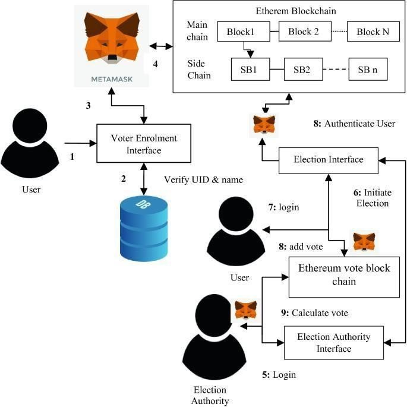
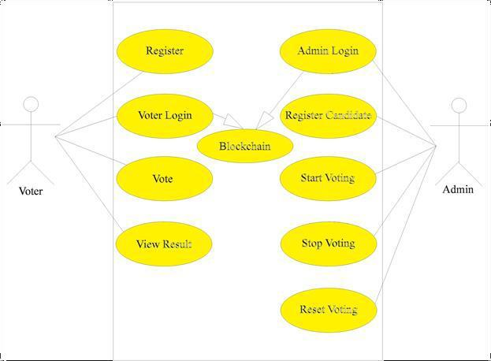
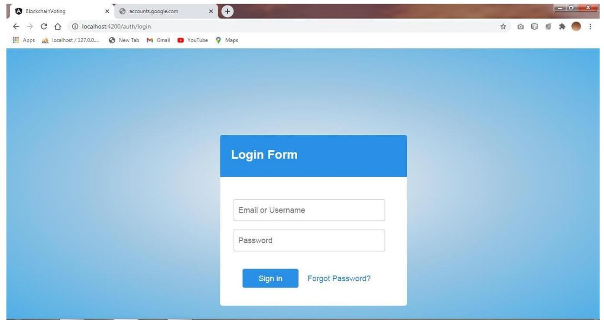
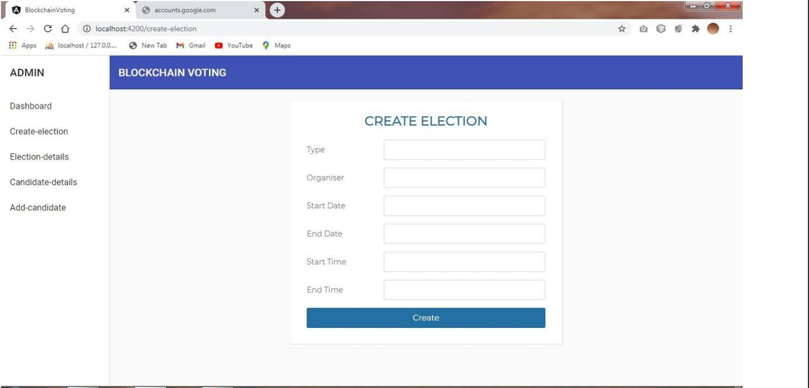

# Blockchain-Based Voting System

A full-stack e-voting web application that uses an Ethereum smart contract to record and count votes, making results tamper-resistant and publicly verifiable, backed by a Node.js/Express web app for registration, login, and admin management.

## Why Blockchain for Voting?

Traditional digital voting systems rely on a central database that an administrator can, in theory, alter. This project stores the actual vote data on a blockchain instead: once a vote is recorded, it cannot be secretly changed, and the rules (who can vote, when, and how many times) are enforced by code rather than by trusting an administrator not to cheat.

## Architecture



- **Smart Contract (Solidity)** — the voting rules and vote tally live on-chain, deployed via Truffle
- **Backend (Node.js / Express)** — handles user registration, login/authentication, admin actions, and serves the frontend
- **Database (MySQL)** — stores voter/user account details (registration, login credentials) separately from the vote data itself, which lives on-chain
- **Frontend (HTML/CSS/JS + EJS templates)** — voter-facing pages (registration, login, voting screen, results) and an admin dashboard

## Smart Contract Design (`contracts/Contest.sol`)

The contract enforces the entire election lifecycle in three phases:

```solidity
enum PHASE { reg, voting, done }
```

- **Registration phase** — the admin (the address that deployed the contract) can add candidates (`addContestant`) and register eligible voter addresses (`voterRegisteration`)
- **Voting phase** — registered voters can call `vote(contestantId)` exactly once each; the contract rejects unregistered addresses and blocks a second vote from the same address
- **Done phase** — voting is closed and results (vote counts per candidate) are final and viewable

Key protections built into the contract:
- `onlyAdmin` — restricts candidate creation, voter registration, and phase changes to the deploying address
- `validState` — ensures actions can only happen in the correct phase (e.g., you can't vote during registration)
- `hasVoted` tracking — each voter's address can only successfully vote once, preventing double-voting

## Use Case Diagram



Voters can register, log in, cast a vote, and view results. Admins log in separately to register candidates and control the election phase (start/stop/reset voting) — all admin actions are enforced on-chain via the `onlyAdmin` modifier in the smart contract.

## Screenshots

**Homepage**


**Voter Sign In**


**Admin Login**


**Admin — Create Election**


## Tech Stack

Solidity · Truffle · Node.js · Express · MySQL · EJS · HTML/CSS/JavaScript

## Project Structure

```
contest/
├── contracts/          # Solidity smart contract (Contest.sol)
├── migrations/         # Truffle deployment scripts
├── test/                # Smart contract tests
├── routes/              # Express routes (login, registration, admin, voting)
├── src/                 # Frontend pages (voting screen, admin panels, results)
├── database.js          # MySQL connection setup
└── truffle-config.js    # Truffle network/compiler configuration
```

## What I Learned

- Writing and testing a Solidity smart contract, including access control (`onlyAdmin`) and state-machine style phase enforcement
- Deploying contracts locally using Truffle and migrations
- Connecting a traditional web backend (Express + MySQL) to a blockchain layer — using the database for account/session management while keeping the actual vote tally on-chain for integrity
- Designing a system where election rules are enforced by code rather than administrator trust

## Setup (for local development)

```
npm install
truffle compile
truffle migrate
npm start
```

*(Requires a local blockchain such as Ganache running, and a MySQL instance configured via `database.js`.)*
